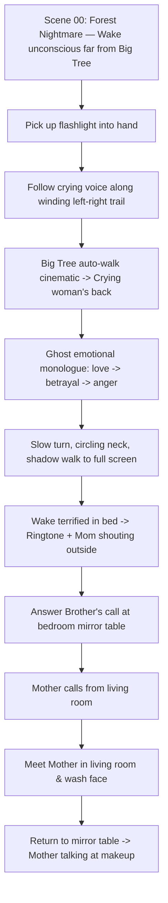

# THAT NIGHT — Chapter 1: The Wedding
## Master First-Person Dialogue, Story Flow & Production Specification

> **CORE CANON & PERSPECTIVE DIRECTIVES**:
> 1. **Perspective**: 100% **First-Person Gameplay** through the eyes of the **Bride**.
> 2. **Character Canon**:
>    * **The Bride**: Main playable protagonist.
>    * **The Mother**: The bride's **biological mother** (STRICT: The mother is NOT the aunt).
>    * **The Brother (male cousin)**: The bride's male cousin away on an important investigation project.
>    * **The Groom**: The bride's future husband.
> 3. **Design Philosophy**: The player must fall in love with the wedding, family, and cultural warmth before the horror strikes. The disappearance must be shocking, tragic, and completely unexplained in Chapter 1.

---

## 1. Scene Flow & Verbatim Dialogue

**Confirmed Chapter 1 First-Half Flow:** Forest Nightmare Opening (wake unconscious deep in forest -> glance confused & hear crying -> pick up flashlight -> follow crying voice along winding left-right trail blocked from wedding house -> reach Big Tree auto-walk cinematic -> Ghost back-turned emotional monologue -> slow turn + circling neck + shadow walk to full screen) -> Wake terrified in bed to ringing phone + Mom shouting from outside -> Answer Mom & answer Brother's call at mirror table -> Mother calls -> Meet Mother in living room -> Wash face in kitchen -> Return to mirror table for makeup conversation with Mother.



---

### Scene 00 — Opening Nightmare: Dark Forest & The Crying Woman
* **Atmosphere Stage**: `AtmosphereStage.NightHorror` (`AmbienceScene.Horror`).
* **Location & Winding Trail**: Bride wakes unconscious deep in the western jungle at `(-1240, 20.88, 560)`—over **1,350m away from the Wedding House** and ~**760m along a winding left-and-right S-curve trail** leading to the **Colossal 20x Sacred World Tree** (`-880, 1020`). A polyline corridor clamp keeps her strictly on the winding trail so she cannot walk straight to the tree or return to the wedding house.
* **Phase 1 — Unconscious Wake-Up & Confused Glance**:
  * Eyes slowly open on the forest floor (`EyelidOverlay`). Camera glances left and right in confusion while spatial female crying (`WomanCrying.wav`) echoes from deeper along the first bend.
* **Phase 2 — Pick Up Flashlight & Follow Winding Trail**:
  * Bride stands up and picks up the 3D flashlight resting beside her into her right hand (single unified SpotLight beam).
  * She follows the 3D crying voice curving right, left, right, left, right through the dense dark woods, guided by subtle beeswax candles and jasmine petals at the bends.
* **Phase 3 — Big Tree Auto-Walk Cinematic & Emotional Monologue**:
  * Reaching the Big Tree glade smoothly auto-walks her behind the crying **Shadow Ghost Woman** (**only her back is visible**).
  * Bride asks why she is crying. The ghost relives her pain aloud—moving from deep love and broken promises, to betrayal and suffering, and finally snapping into pure anger (crying stops, blaming the Bride as her problem)—shifting the Bride's feeling from sympathy to fear.
* **Phase 4 — Transformation & Full-Screen Shadow Scare**:
  * With bone-snapping audio (`NeckCrack.wav`), the ghost rises, **slowly turns around** while twisting her neck in an unnatural circling motion, and stalks forward in a terrifying shadow pose until her dark shadowed face **fills the entire screen**, smash-cutting instantly to pure black.

---

### Scene 02 — Waking Terrified in Bed, Mom Shouting Outside & Brother's Call
* **Time**: 4:00 AM (`AtmosphereStage.Dawn4AM`).
* **Sequence**:
  * Bride jolts awake terrified on her bridal bed pillow (`PlayShockWakeSequence` + `ShockGasp.wav`) while the Nokia phone is **already ringing loudly** on the bedroom mirror table.
  * Mother shouts urgently from outside the closed door because the phone has been ringing for a long time without an answer; the Bride replies, rises from bed, and goes to answer Brother's call, continuing through to Mother talking at makeup.

---

### After Waking - The Phone Call: Brother
* **Location**: Bedroom mirror/dressing table.
* **Hand-Phone Specification**:
  * **Model**: Authentic 2006 classic button **Nokia** candybar phone (graphite/navy housing, rubber keypad, lanyard eyelet).
  * **Screen**: Backlit monochrome green LCD displaying signal bars, battery icon, and **`INCOMING CALL / Brother`**.
  * **Audio**: Iconic 2006 monophonic/polyphonic Nokia ringtone (`NokiaRingtone2006.wav`) and vibrating rumble against the polished timber table (`NokiaVibration.wav`).
* **First-Person Handheld Experience**:
  1. The phone rings and vibrates on the bedroom mirror table as the bride wakes, before she meets Mother.
  2. Prompt: `[E] Answer Nokia Phone`.
  3. The bride's hand reaches down, picks up the Nokia phone, and raises it into first-person view in front of her ear/sightline.
  4. The green LCD screen lights up with caller ID and call timer (`00:01`, `00:02`...).
  5. Looking out through the open wooden shutters into the cool dawn mist, she listens to Brother's voice over the earpiece.
  6. Player retains full mouse-look control while holding the phone.
  7. When the conversation finishes, the classic Nokia two-beep call-ended tone plays (`NokiaCallEnded.wav`), screen reads `CALL ENDED`, and the bride gently sets the phone down.
* **Dialogue**:
  * **Bride:** *"Hello?"*
  * **Brother:** *"Hey. Are you busy?"*
  * **Bride:** *"Not really. I've been waiting for your call."*
  * **Brother:** *"Happy wedding day."*
  * **Bride:** *"That's all? You aren't even coming?"*
  * **Brother:** *"I'm sorry."*
  * **Bride:** *"I really thought you would be here."*
  * **Brother:** *"I wanted to. More than you know."*
  * **Bride:** *"I've been looking forward to today. I thought we'd finally get to spend some time together again."*
  * **Brother:** *"I know. I wanted to see you in your wedding dress. I wanted to be there with everyone."*
  * **Bride:** *"Then why are you still there?"*
  * **Brother:** *"The investigation isn't finished. We've found something, and I can't leave it right now."*
  * **Bride:** *"You always have something important to do."*
  * **Brother:** *"I know I keep disappointing you. I'm sorry."*
  * **Bride:** *"I just wanted you here. That's all."*
  * **Brother:** *"I promise I'll come see you as soon as I finish this."*
  * **Bride:** *"You better. I'm going to hold you to that promise."*
  * **Brother:** *"I will. Now go enjoy your wedding. Don't let me ruin your day."*
  * **Bride:** *"I wish you were here."*
  * **Brother:** *"I wish I was there too."*
  * *[Short silence]*
  * **Bride:** *"Take care of yourself, okay?"*
  * **Brother:** *"You too. And congratulations."*
  * *[Call ends. Bride lowers phone slowly. Gentle breath.]*
  * **Mother (calling from another room):** *"Sweetheart! Are you ready?"*
  * **Bride:** *"Almost, Mom!"*

---

### After the Phone Call - Mother Calls
* **Perspective**: First-Person (Bride's POV).
* **Actions**: After putting the phone down, hear Mother, leave the bedroom, and open the door.
* **Dialogue**:
  * **Mother (outside bedroom):** *"You're awake already?"*
  * **Bride:** *"Yes, Mom. I'm coming."*
  * **Mother:** *"Today is your big day. Don't stay in bed too long."*
  * **Bride:** *"I know, Mom."*
  * **Mother:** *"Come downstairs when you're ready. We still have so much to do."*
  * **Bride:** *"Okay!"*

---

### Living Area - Mother and Daughter
* **Location**: Central living hall (*Rong Doung*).
* **Actions**: Walk into living room, approach Mother who is organizing ceremonial offerings and wedding arrangements.
* **Dialogue**:
  * **Mother:** *"There you are."*
  * **Bride:** *"What are you doing, Mom?"*
  * **Mother:** *"Checking everything for today. I don't want anything to be forgotten."*
  * **Bride:** *"You've been awake since early morning?"*
  * **Mother:** *"Of course. Do you think your wedding prepares itself?"*
  * **Bride:** *"Haha. You should have woken me up."*
  * **Mother:** *"You needed your sleep. Today will be a long day."*
  * **Bride:** *"Is everything ready?"*
  * **Mother:** *"Almost everything. The guests will start arriving later."*
  * **Bride:** *"I'm a little nervous."*
  * **Mother:** *"That's normal, sweetheart."*
  * **Bride:** *"What if something goes wrong?"*
  * **Mother:** *"Then we'll handle it together. Don't worry."*
  * **Bride:** *"Okay, Mom."*
  * **Mother:** *"Your things are ready at the mirror. I'll help you get dressed."*

---

### Scene 05 — Wedding Preparation: Mother & Daughter
* **Location**: Bridal Bedroom dressing table and mirror.
* **Actions**: Return to bedroom, sit before the dressing mirror. Mother joins her, adjusting the gold jewelry and silk *Sbai*. Mirror reflects the bride's transformation into a Khmer bride.
* **Dialogue**:
  * **Mother:** *"Come here, sweetheart. Let's get you ready."*
  * **Bride:** *"Mom, is my dress ready?"*
  * **Mother:** *"Everything is ready. I checked it twice."*
  * **Bride:** *"You're more nervous than I am."*
  * **Mother:** *"Of course I am. My daughter is getting married today."*
  * **Bride:** *"You're making it sound like I'm leaving forever."*
  * **Mother:** *"You're starting a new life. That's different."*
  * **Bride:** *"I'll still come home and visit you."*
  * **Mother:** *"You better. I don't want you forgetting your mother."*
  * **Bride:** *"Never."*
  * **Mother:** *"Look at you. My little girl is growing up."*
  * **Bride:** *"Mom, don't cry."*
  * **Mother:** *"I'm not crying."*
  * **Bride:** *"You are!"*
  * **Mother:** *"I'm just happy, sweetheart."*
  * **Bride:** *"I love you, Mom."*
  * **Mother:** *"I love you too."*

---

### Scene 06 — Traditional Wedding Ceremony
* **Atmosphere Stage**: `AtmosphereStage.AfternoonCelebration` (Bright golden daylight, festive wedding marquee).
* **Audio**: Authentic Khmer wedding orchestra (*Phleng Kar* — Pinpeat, Tro, Roneat Ek).
* **Rites**: Groom procession, fruit offerings, hair cutting (*Gaat Sah*), wrist-tying (*Sompeas Ptem*) with sacred red thread and *Pka Sla* flowers.
* **Dialogue (Mother & Bride)**:
  * **Mother:** *"Are you ready?"*
  * **Bride:** *"I think so."*
  * **Mother:** *"Don't be nervous. Just smile."*
  * **Bride:** *"You're staying with me, right?"*
  * **Mother:** *"Of course. I'm right here."*
  * **Bride:** *"Thank you, Mom."*
  * **Mother:** *"Now go. Everyone is waiting."*
* **Dialogue (Bride & Groom)**:
  * **Groom:** *"You look beautiful."*
  * **Bride:** *"Thank you."*
  * **Groom:** *"Are you nervous?"*
  * **Bride:** *"A little. What about you?"*
  * **Groom:** *"Honestly? Very."*
  * **Bride:** *"I thought you would be confident."*
  * **Groom:** *"Not when I'm standing in front of you."*
  * **Bride:** *"Haha. You're silly."*
  * **Groom:** *"But I'm happy."*
  * **Bride:** *"Me too."*
* **Guest Ambience**: Spatial audio greetings ("Congratulations!", "They look wonderful together!", "May they have a happy life together!").

---

### Scene 07 — Wedding Reception: Evening
* **Atmosphere Stage**: `AtmosphereStage.EveningWarm` (Warm tungsten string bulbs, dusk to evening).
* **Actions**: Walk around tables, observe dancing (*Romvong*), greet relatives.
* **Dialogue (Mother & Daughter)**:
  * **Mother:** *"Are you enjoying yourself?"*
  * **Bride:** *"Yes, Mom. It's been wonderful."*
  * **Mother:** *"I'm glad."*
  * **Bride:** *"I wish everyone could be here."*
  * **Mother:** *"I know who you're thinking about."*
  * **Bride:** *"He really wanted to come."*
  * **Mother:** *"I'm sure he did. Don't be sad today."*
  * **Bride:** *"I know."*
  * **Mother:** *"Today is your day. Enjoy every moment."*
* **Dialogue (Bride & Groom)**:
  * **Groom:** *"You've been smiling all evening."*
  * **Bride:** *"It's my wedding. I'm allowed to."*
  * **Groom:** *"You look tired, though."*
  * **Bride:** *"A little."*
  * **Groom:** *"It's been a long day. Shall we go inside?"*
  * **Bride:** *"Okay. Just let me say goodbye to Mom."*
* **Dialogue (Goodnight to Mother)**:
  * **Bride:** *"Mom, we're going inside now."*
  * **Mother:** *"Alright, sweetheart. Get some rest."*
  * **Bride:** *"You should rest too."*
  * **Mother:** *"I will. Don't worry about me."*
  * **Bride:** *"Goodnight, Mom."*
  * **Mother:** *"Goodnight, my daughter."*

---

### Scene 08 — The Disappearance: Horror Climax
* **Atmosphere Stage**: `AtmosphereStage.NightHorror` (Late night, darkness outside).
* **Progression**:
  * **Phase 1 (Entering Room)**: Door closes, wedding music becomes muffled through timber walls.
    * **Groom:** *"Finally, some quiet."*
    * **Bride:** *"It's been a long day."*
    * **Groom:** *"A good one, though."*
    * **Bride:** *"The best."*
  * **Phase 2 (Disturbance)**: Deep acoustic resonance from beneath the stilt house floorboards. The room becomes unnaturally quiet. Light bulb flickers.
    * **Groom:** *"Did you hear that?"*
    * **Bride:** *"Hear what?"*
    * **Groom:** *"I thought someone was outside."*
    * **Bride:** *"Maybe it's just the guests."*
    * *[Sudden loud anomalous noise from below]*
    * **Groom:** *"Wait..."*
  * **Phase 3 (Blackout & Scream)**: Violent unnatural shockwave shakes room, camera distorts violently, sudden blackout, crash sound, sharp bloodcurdling scream!
  * **Phase 4 (Guest Reaction Outside)**:
    * **Guest:** *"What was that?!"*
    * **Mother:** *"That came from their room!"*
    * **Guest:** *"Open the door!"*
    * **Mother:** *"Where is my daughter?!"*
  * **Phase 5 (Empty Room)**:
    * Door bursts open with flashlight beams.
    * **The room is completely empty.**
    * Bride and groom are gone without a trace; wedding jewelry and belongings remain untouched.
    * **Mother (crying desperately):** *"Sweetheart?! ... Please answer me! ... No... no, this can't be happening!"*
    * Cut to black.

---

### Scene 09 — Final Cinematic & Title Reveal
* **Shot List**:
  * **Shot 01 (Static Wide)**: Relatives frantically searching around the empty room and hallway.
  * **Shot 02 (Slow Backward Dolly)**: Camera leaves the bedroom door.
  * **Shot 03 (Tracking)**: Floats through the dark stilt house hallway.
  * **Shot 04 (Exterior)**: Camera passes out through the open veranda into the cold night air.
  * **Shot 05 (Crane Upward)**: Ascends above the timber roof tiles.
  * **Shot 06 (Aerial Wide)**: Lonely illuminated house surrounded by vast, pitch-black Cambodian jungle.
  * **Shot 07 (Fade to Black)**: Screen fades to pure black.
  * **Shot 08 (Title Reveal)**:
    ```
    A CAMBODIAN SUPERNATURAL HORROR GAME

    THAT NIGHT

    CHAPTER ONE — THE WEDDING
    ```

---

## 2. Technical Presentation Rules (Unity 6)
1. **Dialogue UI & Presentation**:
   * Voice acting + clean, legible subtitles (Cambodian & English localization ready).
   * Spatial 3D audio for dialogue and village ambience.
   * NPCs turn their head/upper body to face the player's camera naturally when addressing the bride.
2. **First-Person Immersion**:
   * Player can freely look around during dialogue; movement can be gently clamped or guided during focused emotional beats.
   * No third-person perspective cuts during playable moments.
   * Natural eye level at **1.54m** for authentic female stature.
